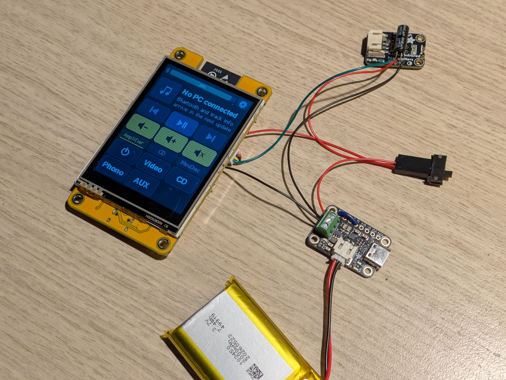
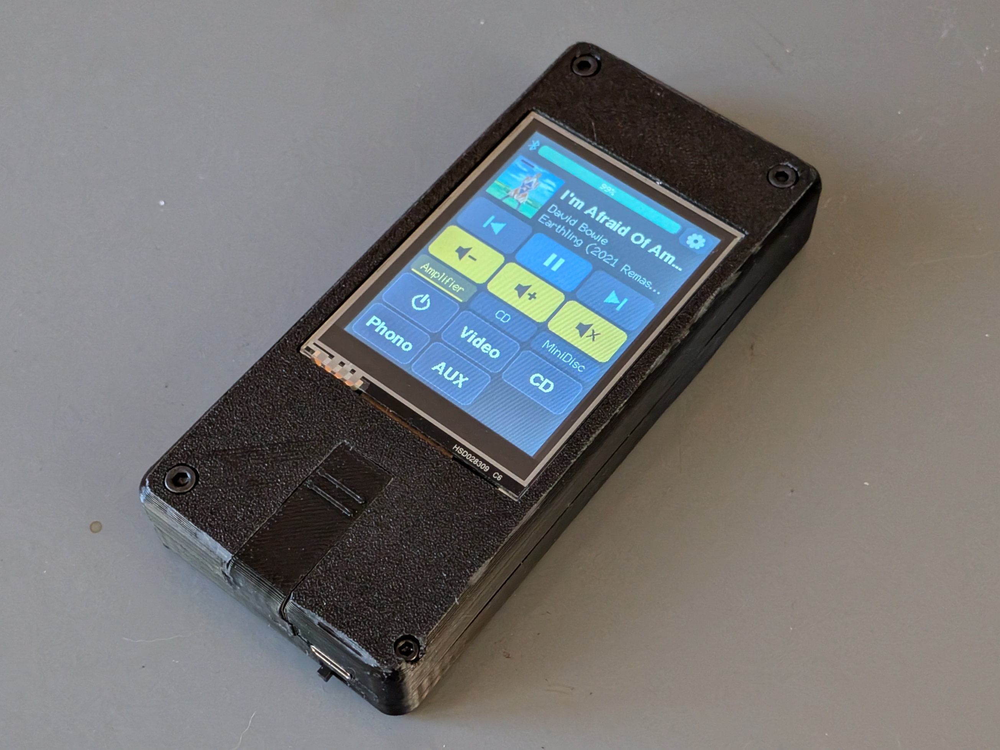

## The 3D printed enclosure
You'll also need nuts and screws and of course all the wiring and the rest of the hardware.

- Print the STL files with 3 times outer loop, so you'll have some 'meat' to tap the srews into.
- The Insert.STL and the Top-half.STL need supports.
- The Freenove main board gets screwed into the top half with some very short and flat screws of M1.5.
- You'll need some more of these small screws (the type you'll find inside laptops) to secure the Adafruit IR board and Adafruit charger board.
- The small switch gets popped into its space under the charger board (tight fit). I used a 3 pin Dupont case for just two leads here to nicely fill up the space).
- Attach the battery and close the device with one M2.5x12 Hex nut bolt, and three M3.0x12 Hex nut bolts.

The Insert.STL is to cover the Freenove's USB port which you'll only need to flash the board. Make sure to turn the Power switch to OFF before connecting the Main board to a PC (or any other powered port). 
Normal operation/charging is done through the Adafruit's USB-C port. 

### See below pictures for further assembly... 😎

</img>

Carefull when sliding in the Insert. It has space cut out to miss the battery cable and plug, just be gentle 😏

</img>

## List of parts:
- 4x M1.5x5 Flat head screws (wide and very flat head)
- 4x M1.5x5 Flat head screws (laptop internal type ones, like the ones holding the LCD to the frame)
- 1x M2.5x12 Hex Nut bolt
- 1x Mini switch in this exact size: https://www.kiwi-electronics.com/nl/mini-schuifschakelaar-spdt-3866?search=switch
- The wires that come with the Freenove board
- A Dupont crimp set
- Soldering gear

The used boards all listed on Main...
